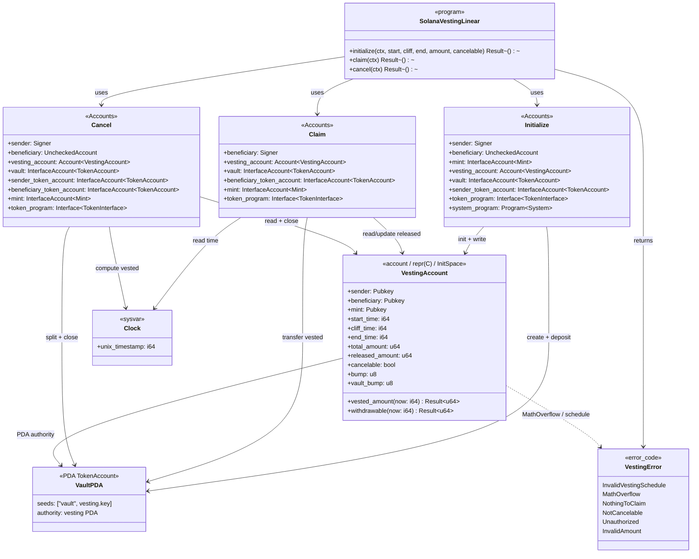
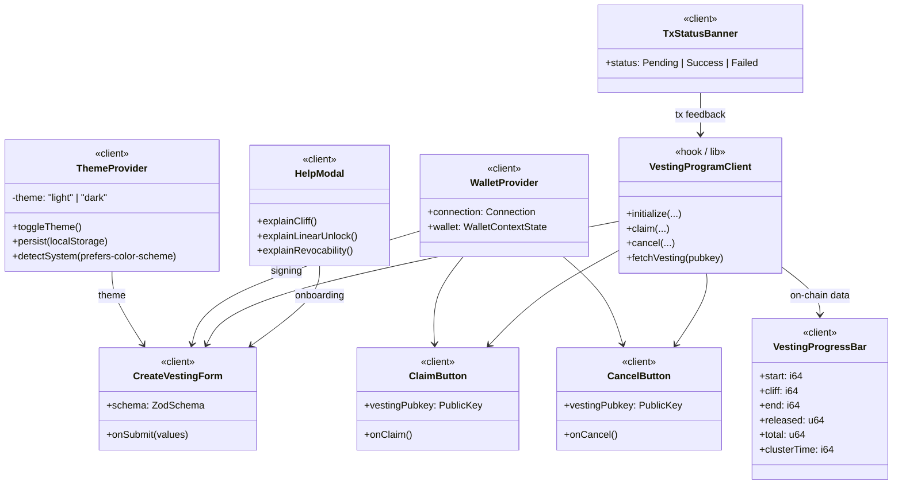

# Class diagram — solana-vesting-linear

Structural view of the on-chain domain (Anchor) and the frontend layer (Next.js).  
Syntax: Mermaid `classDiagram`.

---

## 1. On-chain domain (Anchor program)

### Design notes

| Element | Decision |
|---------|----------|
| `VestingAccount` | `#[repr(C)]` + `InitSpace`; space = `8 + INIT_SPACE` |
| Tokens | `token_interface` → SPL Token and Token-2022 |
| Clock | `Clock` sysvar only; never a client timestamp |
| Closing | `close = sender` on cancel / full claim |

---

## 2. Frontend layer (Next.js / React)

### Typing contracts (frontend)

- Typed props and return values; **no `any`**.
- Forms and params validated with **Zod**.
- Every component/hook has **JSDoc** (`@description`, `@param`, `@returns`).
