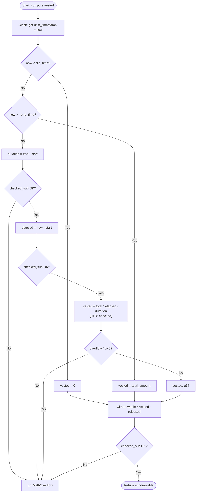
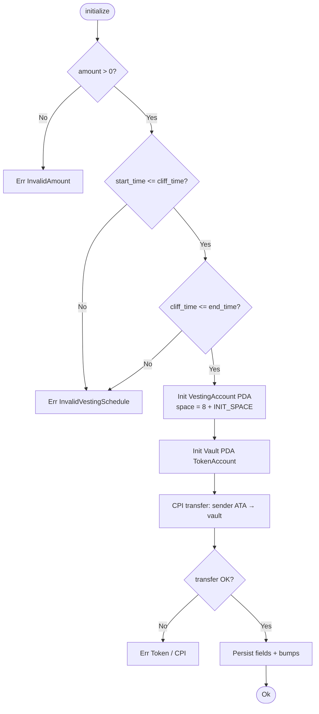
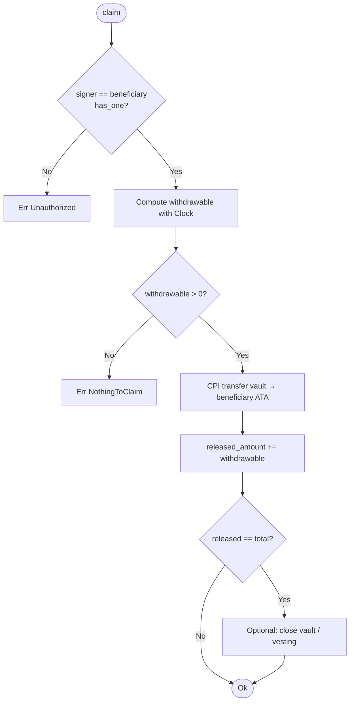
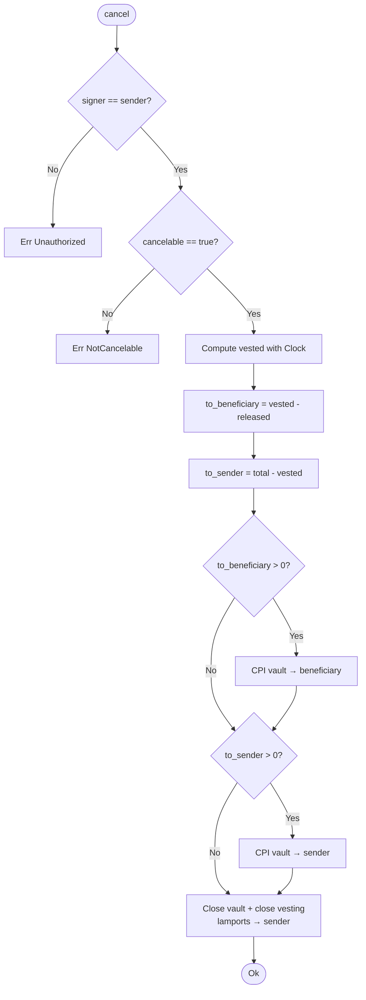

# Flow diagram — on-chain logic

Algorithmic decisions of the program: schedule validation, linear calculation and the branches of each instruction.  
Syntax: Mermaid `flowchart`.

---

## 1. Computing `vested_amount` / `withdrawable`



---

## 2. Instruction `initialize`



---

## 3. Instruction `claim`



---

## 4. Instruction `cancel`



---

## Temporal invariants

```text
start_time  ≤  cliff_time  ≤  end_time
released_amount  ≤  vested(now)  ≤  total_amount
```

Any schedule violation in `initialize` → `InvalidVestingSchedule`.  
Arithmetic overflow → `MathOverflow` (no panic / no unwrap).
