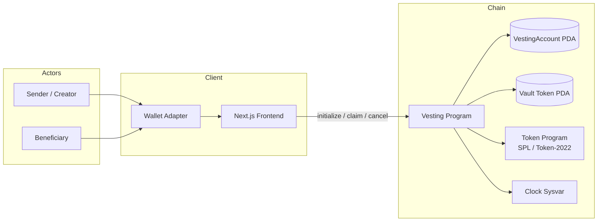
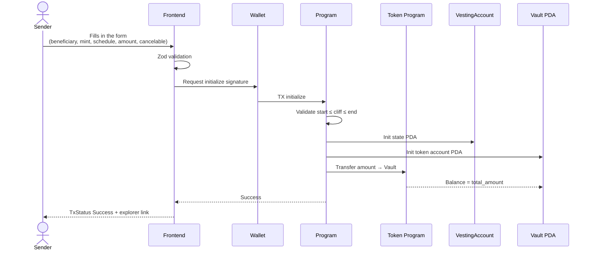
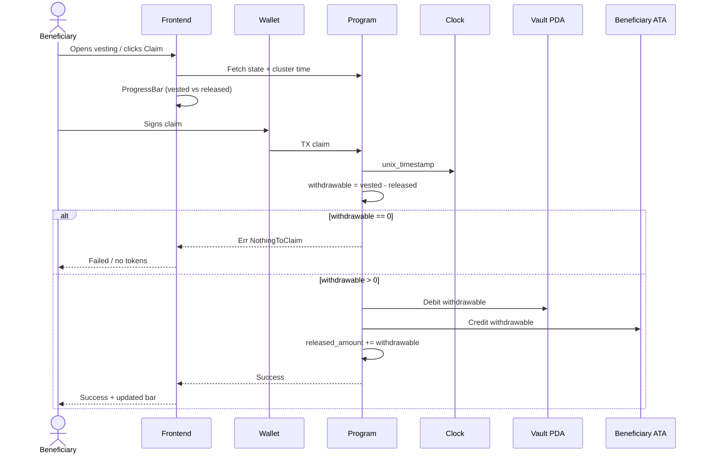
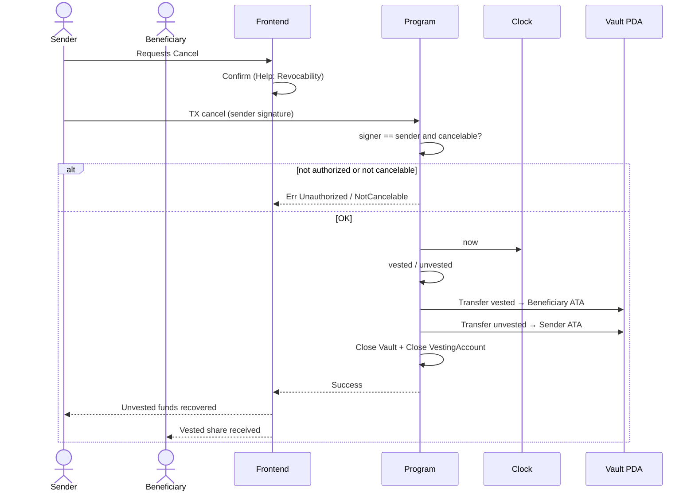
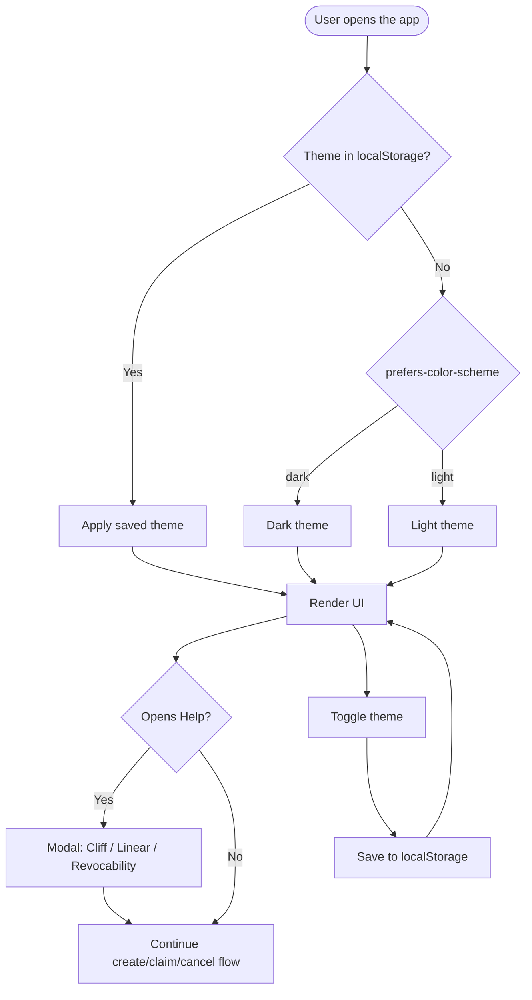
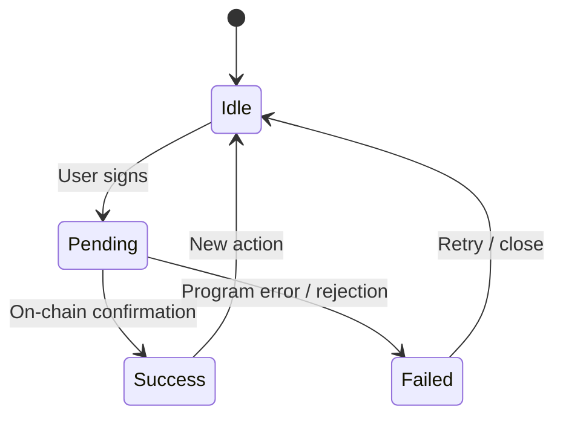

# Process flowchart — actors and business processes

Interaction sequence between **Sender**, **Beneficiary**, **Frontend**, **Program** and **Token Program**.  
Complements the flow diagram (internal decisions) with the end-to-end process view.

---

## 1. General lifecycle flowchart

---

## 2. Process: create vesting (Sender)

---

## 3. Process: claim tokens (Beneficiary)

---

## 4. Process: revoke vesting (Sender)

---

## 5. UX flowchart: theme and help

---

## 6. Transaction states (UI feedback)

---

## Role legend

| Role | Can |
|------|-----|
| **Sender** | `initialize`, `cancel` (if `cancelable`) |
| **Beneficiary** | `claim` already vested tokens |
| **Frontend** | Validate inputs, show progress and Help; does **not** decide vesting time |
| **Program** | Single source of truth for time (`Clock`) and balances |
